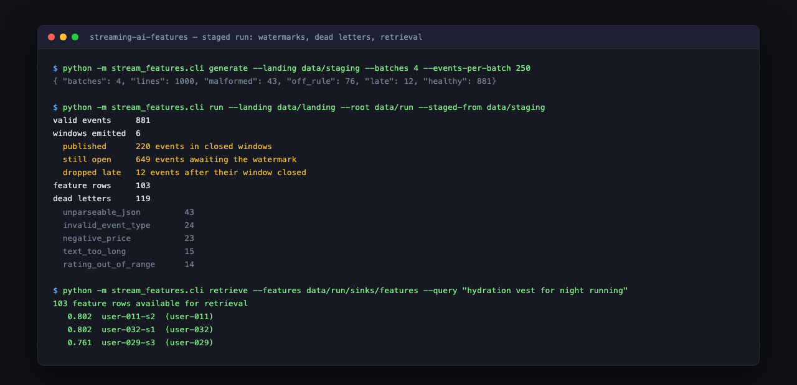

# Streaming Event Pipeline with AI-Ready Features

Tracker events in, trustworthy windowed metrics and per-session vectors out — with malformed records
quarantined and late records *counted* instead of silently discarded.

Real-time pipelines fail in three specific ways: a single malformed event kills the query, a
dashboard shows a half-finished number because nobody used a watermark, and events that arrive late
vanish without anyone noticing. This project handles all three explicitly, and every outcome is a
number in the run report.



## What it does

1. **Ingests** newline-delimited events from a landing directory as a stream of raw text.
2. **Validates** each record against a written schema and quarantines failures with a
   machine-readable reason — malformed JSON included, so one bad line never stops the query.
3. **Windows** the stream with a watermark and tumbling windows, so a metric is published only once
   its window has closed.
4. **Builds features** per session — counts, spend, duration — plus a 32-dimension hashed text
   embedding, which is the vector a model or a retrieval layer needs.
5. **Reports** what happened to every event: published, still open, dropped late, or quarantined.

## Quickstart

```bash
python3 -m venv .venv
.venv/bin/pip install -e '.[dev]'

# 1. write event batches (including deliberately awkward ones) to a staging directory
python -m stream_features.cli generate --landing data/staging --batches 4 --events-per-batch 250

# 2. feed them in one file at a time so the watermark advances like a real stream
python -m stream_features.cli run --landing data/landing --root data/run --staged-from data/staging

# 3. cosine-search the emitted vectors
python -m stream_features.cli retrieve --features data/run/sinks/features --query "hydration vest for night running"
```

```text
valid events     881
windows emitted  6
  published      220 events in closed windows
  still open     649 events awaiting the watermark
  dropped late   12 events after their window closed
feature rows     103
dead letters     119
  unparseable_json         43
  invalid_event_type       24
  negative_price           23
  text_too_long            15
  rating_out_of_range      14
```

Drop `--staged-from` to process everything in a single pass; the same numbers then show
`dropped late 0`, because with every file present at startup nothing is late — which is worth
knowing and is asserted by a test.

## The three-way split, and why it matters

`published + still open + dropped late == valid events` is an invariant the test suite enforces,
because the three outcomes mean different things:

| Outcome | Meaning | What an operator should do |
| --- | --- | --- |
| **published** (220) | The window closed and its result is in the sink | Nothing |
| **still open** (649) | The watermark has not passed the window yet | Nothing — this is the guard that stops half-finished numbers reaching a dashboard |
| **dropped late** (12) | The window closed *before* the event arrived | Check the producer's clock: something is emitting data 30 minutes behind |

Without the third category, a producer drifting behind would look like traffic simply falling, and
nobody would investigate.

## Dead letters

Every rejected row keeps its raw payload and one stable reason, so the queue can be queried rather
than browsed. Reasons are single-valued and priority-ordered: a row that breaks several rules gets
the first one, which keeps counts comparable over time.

Malformed JSON is detected with `get_json_object(raw, "$")` rather than a Python UDF — `from_json`
is permissive and returns a struct of nulls for an unparseable line, so the raw text is the only
honest source of truth, and a UDF would tax every row in the stream.

## AI-ready features

`session_features` produces one row per session with counts, spend, average duration, and an
embedding of the session's search queries and review text. The embedder is a **signed hashing
trick** — hash each token into one of 32 buckets, with a second hash choosing `+1` or `-1` — so
collisions cancel instead of reinforcing, similarity stays meaningful, and there is no vocabulary
file to ship or drift.

```text
$ python -m stream_features.cli retrieve --features data/run/sinks/features --query "hydration vest for night running"
103 feature rows available for retrieval
   0.802  user-011-s2  (user-011)
   0.802  user-032-s1  (user-032)
   0.761  user-029-s3  (user-029)
```

That is the plumbing a retrieval-augmented system needs before any model is involved: the stream
keeps vectors fresh, and a request finds the closest ones by cosine similarity. An exact-text query
scores 1.000, which is the expected behaviour of a hash-based embedder and is covered by a test.

## How this maps onto a real broker

The source is `spark.readStream.text(landing)`. Everything downstream — schema enforcement, the
dead-letter branch, the watermark, the windowed aggregation, the feature sink — is unchanged if the
source becomes Kafka:

```python
raw = (spark.readStream.format("kafka")
       .option("kafka.bootstrap.servers", "...")
       .option("subscribe", "tracker.events")
       .load()
       .select(F.col("value").cast("string").alias("value")))
```

The file source is used because it makes the semantics testable: `availableNow` drains a directory
and terminates, so the correctness tests get deterministic answers in seconds instead of requiring
a broker and a sleep. That trade-off is deliberate, and the operator used in production
(`trigger(availableNow=True)`) is the same one the tests use.

## Tests

```bash
.venv/bin/python -m pytest -q     # 24 passed (~5 min, one shared JVM)
.venv/bin/ruff check .
```

They cover validation and reason priority, quarantined rows keeping their raw payload, the
three-way window split (including the invariant), staged arrival genuinely dropping late events, the
embedder's determinism and the zero vector for empty text, feature scaling, retrieval ranking,
checkpointing (a second run must not reprocess the same files), and picking up a newly arrived file.

## Deliberate limitations

- **The source is a file directory, not a broker.** The streaming semantics are real; the transport
  is not, and the swap is documented above rather than pretended away.
- **The embedder is not a language model.** It is a deterministic hashing vectoriser: cheap, stable,
  and dependency-free, but it will not understand synonyms. Swapping in a real embedding model is a
  single function change and a much larger dependency.
- **Dropped late events are counted, not rescued.** A production system would route them to a side
  output or a replay table; here they are deliberately visible as a number instead.
- **Nothing here has run under sustained load.** The tests are bounded and small; throughput,
  backpressure, and state-store growth on a real stream are untested.
- **Feature windows are re-emitted per window**, so a session spanning two windows appears twice.
  Sessionisation across windows needs state that this pipeline does not keep.

## Next

1. **Swap the source for Kafka** and run it against a real topic, then measure end-to-end latency
   from producer timestamp to published window.
2. **Route late events to a side output** instead of dropping them, so a behind-schedule producer
   can be replayed rather than merely reported.
3. **Persist the vectors in a real index** (pgvector, LanceDB) so retrieval scales past a
   `collect()`, and serve them behind an API.
4. **Train on the features** — a churn or next-purchase model — which is the point of making the
   stream AI-ready in the first place.
